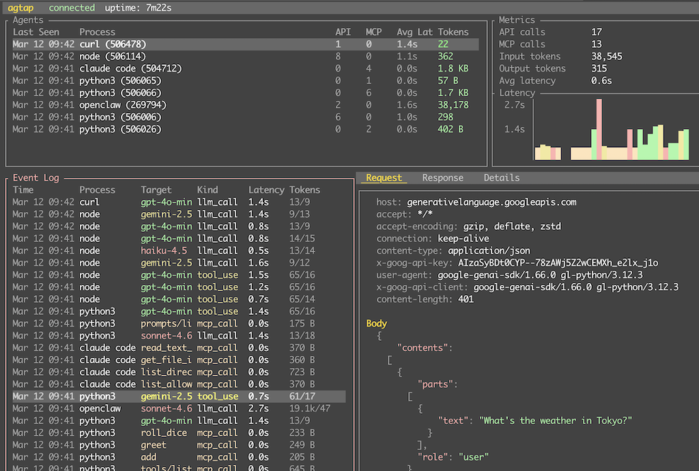

# agtap

eBPF-based LLM API and MCP call tracer for Linux. Captures Anthropic, OpenAI, Google Gemini, and MCP traffic with zero application changes. Uses eBPF to intercept TLS via OpenSSL uprobes and I/O via kernel probes. OTel and Prometheus metrics out of the box.



## Requirements

- Linux 5.8+ with BTF support
- Root privileges for the daemon (TUI does not need root)
- glibc 2.35+ (Ubuntu 22.04+, Debian 12+, Fedora 36+, etc.)

## Install

**Quick install:**

```
curl -sSL https://raw.githubusercontent.com/zhebrak/agtap/main/install.sh | sudo sh
```

**Manual download:** grab the latest tarball and checksum from [GitHub Releases](https://github.com/zhebrak/agtap/releases), verify, and extract:

```
tar xzf agtap-v*.tar.gz
sudo mv agtap /usr/local/bin/
```

**Build from source:**

```
cargo build -p agtap --release
```

See [CONTRIBUTING.md](CONTRIBUTING.md#building-from-source) for full build instructions.

## Quick start

Start the daemon (captures traffic and writes events):

```
sudo agtap
```

Connect the live dashboard (no root needed):

```
agtap tui
```

## What it captures

- **Anthropic** (`/v1/messages`) — streaming & non-streaming, tool use, cache tokens, error responses
- **OpenAI** (`/v1/chat/completions`, `/v1/responses`) — streaming & non-streaming, function calls, error responses
- **Google Gemini** (`generateContent`, `streamGenerateContent`) — streaming & non-streaming, function calls, cache tokens, error responses. Google AI and Vertex AI endpoints.
- **MCP** (Model Context Protocol) — JSON-RPC 2.0 over stdio pipes and HTTP, including notifications

Per call: model, input/output tokens, latency, time-to-first-token, stop reason, tool names, streaming status, full request/response bodies.

### Runtimes & frameworks

| Scenario | How |
|----------|-----|
| Python (requests, httpx, aiohttp) | OpenSSL via `ssl` module + glibc `send`/`recv` |
| Node.js (official binaries, nvm, distro packages) | Statically linked OpenSSL with exported symbols, or shared libssl |
| Node.js MCP servers (stdio pipes) | `vfs_writev`/`vfs_readv` kprobes (libuv) |
| curl HTTPS (with `--http1.1`) | OpenSSL uprobes (curl defaults to HTTP/2; use `--http1.1`) |
| curl, Ruby, Java plain HTTP | glibc `send`/`recv` uprobes |
| musl libc (Alpine containers) | musl `send`/`recv` uprobes + `vfs_writev`/`vfs_readv` kprobes |
| Rust with `native-tls` (OpenSSL) | OpenSSL uprobes |
| LangChain, CrewAI, AutoGen (Python) | Same as Python |
| Claude Code (MCP tool calls) | `vfs_writev`/`vfs_readv` kprobes (stdio pipes/socketpair) |
| OpenClaw (Node.js) | Same as Node.js |

<details>
<summary>What's NOT captured</summary>

- **Bun** — uses BoringSSL with stripped symbols; not matched by uprobes
- **Deno** — uses rustls (pure Rust TLS); no `SSL_read`/`SSL_write` symbols
- **Go agents** — `crypto/tls` is built into the Go runtime; no OpenSSL symbols
- **Rust with rustls** — pure Rust TLS; no standard symbol exports
- **Java/Kotlin TLS** — uses JSSE, not OpenSSL (plain HTTP works via glibc)
- **Electron apps** — BoringSSL via Chromium; same limitation as Bun (unless SSL symbols are exported, in which case it works)
- **Stripped/static binaries** — if OpenSSL is statically linked without exported symbols, detection fails
- **HTTP/2 and HTTP/3** — only HTTP/1.1 is reassembled; h2 binary framing and QUIC are not parsed
- **Other API endpoints** — embeddings, assistants, batch, image APIs are not parsed (only `/v1/messages`, `/v1/chat/completions`, `/v1/responses`, `generateContent`, `streamGenerateContent`)

</details>

## Configuration

### Flags

| Flag | Description |
|------|-------------|
| `-p, --pid <PID>` | Target a specific process |
| `-c, --comm <NAME>` | Target by process name (e.g., `python3`) |
| `-v, --verbose` | Show BPF loading and TLS discovery details |
| `--otel <ENDPOINT>` | Export traces via OpenTelemetry (e.g., `http://localhost:4318`) |
| `--metrics-addr <ADDR>` | Expose Prometheus metrics (e.g., `127.0.0.1:9464`) |
| `--max-body-store <MB>` | Max body storage on disk (default: 500 MB) |
| `--body-retention <HOURS>` | Body file retention period (default: 24h) |
| `--max-body-retain-kb <KB>` | Max request/response body retained per detail file (default: 512 KiB, hard cap: 2 MiB; values above the cap fail rather than silently truncating Go syscall capture) |

For a selected `--pid`/`--comm` target, agtap refuses to start if the Go direct-syscall tracepoint programs cannot load and attach. This prevents a static Go server from running with an apparent collector but no plaintext HTTP capture.
| `--max-log-size <MB>` | Max event log size before rotation (default: 50) |
| `--max-log-files <N>` | Max rotated log files to keep (default: 3) |
| `--archive-s3-endpoint <URL>` | S3-compatible endpoint, such as MinIO; omit for AWS S3 |
| `--archive-s3-bucket <BUCKET>` | Enable asynchronous archive uploads to this bucket |
| `--archive-s3-prefix <PREFIX>` | Object key prefix (default: `agtap`) |
| `--archive-s3-region <REGION>` | S3 signing region (default: `us-east-1`) |
| `--archive-retry-delay-secs <SECONDS>` | Base delay for failed archive retries (default: 5) |

### Environment variables

| Variable | Description |
|----------|-------------|
| `AGTAP_LOG` | Override default event log path (default: `/tmp/agtap/events.jsonl`) |
| `AGTAP_SOCK` | Override default Unix socket path (default: `/tmp/agtap/agtap.sock`) |
| `AWS_ACCESS_KEY_ID` / `AWS_SECRET_ACCESS_KEY` | Credentials loaded by the AWS SDK; never put them in arguments or files committed to the repository |
| `AWS_SESSION_TOKEN` | Optional session credential loaded by the AWS SDK |

## Output

- **JSONL** — to stdout and `/tmp/agtap/events.jsonl`
- **Bodies** — full request/response payloads in `/tmp/agtap/bodies/`
- **S3 archive** — rotated event JSONL and referenced body JSON are packaged and uploaded asynchronously; pending jobs live under `/tmp/agtap/archive/`
- **TUI** — live terminal dashboard via Unix socket
- **OpenTelemetry** — OTLP/HTTP export
- **Prometheus** — `/metrics` endpoint

### JSONL event schema

```json
{
  "ts": "2023-11-14T22:13:21.000Z",
  "id": "msg_snapshot",
  "pid": 42,
  "proc": "python3",
  "provider": "anthropic",
  "server_address": "api.anthropic.com",
  "kind": "llm_call",
  "model": "claude-haiku-4-5-20251001",
  "input_tokens": 100,
  "output_tokens": 25,
  "latency_ms": 1000,
  "stop_reason": "end_turn",
  "tools": [],
  "streaming": false,
  "ttft_ms": 500,
  "request_bytes": 256,
  "response_bytes": 512
}
```

| Field | Type | Description |
|-------|------|-------------|
| `ts` | string | Wall-clock ISO 8601 timestamp |
| `id` | string | API response ID (`msg_...`, `chatcmpl-...`) |
| `pid` | number | Process ID |
| `proc` | string | Process name |
| `provider` | string | `anthropic`, `openai`, `google`, or `mcp` |
| `server_address` | string | Target host |
| `kind` | string | `llm_call`, `tool_use`, or `mcp_call` |
| `model` | string | Model name or MCP method |
| `input_tokens` | number? | Input tokens (absent for MCP) |
| `output_tokens` | number? | Output tokens (absent for MCP) |
| `cache_creation_input_tokens` | number? | Cache creation tokens (Anthropic) |
| `cache_read_input_tokens` | number? | Cache read tokens (Anthropic, Gemini) |
| `latency_ms` | number | Request-to-response latency in ms |
| `stop_reason` | string | Stop reason (`end_turn`, `stop`, `error:...`) |
| `tools` | string[] | Tool names used |
| `streaming` | boolean | Whether response was SSE-streamed |
| `ttft_ms` | number? | Time to first token (typically present for streaming) |
| `body_path` | string? | Path to full HTTP body JSON |
| `request_bytes` | number? | Raw request size |
| `response_bytes` | number? | Raw response size |

### Prometheus metrics

| Metric | Type | Labels | Description |
|--------|------|--------|-------------|
| `agtap_request_duration_seconds` | histogram | `model`, `provider`, `process`, `kind`, `streaming` | Call latency |
| `agtap_token_count` | histogram | `model`, `provider`, `process`, `kind`, `streaming`, `token_type` | Token counts |
| `agtap_time_to_first_token_seconds` | histogram | `model`, `provider`, `process`, `kind`, `streaming` | TTFT |
| `agtap_requests` | counter | `provider`, `process`, `kind`, `streaming`, `status` | Total requests |
| `agtap_request_bytes` | histogram | `model`, `provider`, `process`, `kind`, `streaming` | Request body size |
| `agtap_response_bytes` | histogram | `model`, `provider`, `process`, `kind`, `streaming` | Response body size |

### OpenTelemetry

Spans follow [GenAI semantic conventions](https://opentelemetry.io/docs/specs/semconv/gen-ai/):

**Span attributes:** `gen_ai.operation.name`, `gen_ai.provider.name`, `gen_ai.request.model`, `gen_ai.response.id`, `gen_ai.response.finish_reasons`, `gen_ai.usage.input_tokens`, `gen_ai.usage.output_tokens`, `gen_ai.usage.cache_creation_input_tokens`, `gen_ai.usage.cache_read_input_tokens`, `server.address`

**Custom attributes:** `agtap.pid`, `agtap.process`, `agtap.kind`, `agtap.streaming`, `agtap.tools`, `agtap.ttft_ms`, `agtap.request_bytes`, `agtap.response_bytes`

**OTel metric instruments** (different names from Prometheus):

| Instrument | Unit | Description |
|------------|------|-------------|
| `gen_ai.client.operation.duration` | s | Call latency |
| `gen_ai.client.token.usage` | {token} | Token counts |
| `gen_ai.server.time_to_first_token` | s | TTFT |

## Troubleshooting

**No SSL symbols detected** — the target process's libssl must have exported symbols. Statically linked or stripped OpenSSL builds won't be matched. Check with `nm -D /path/to/libssl.so | grep SSL_read`.

**Permission denied** — the daemon requires root to load eBPF probes. Run with `sudo agtap`.

**No events captured** — verify the target process uses a supported TLS library (OpenSSL with exported symbols). BoringSSL (Bun, Electron), rustls (Deno), and Go's crypto/tls are not supported.

**HTTP/2 traffic not captured** — only HTTP/1.1 is supported. For curl, use `curl --http1.1`.

## Uninstall

```
agtap clean
sudo rm /usr/local/bin/agtap
```

`agtap clean` removes runtime data (`/tmp/agtap/`). Then remove the binary.

---

See [CONTRIBUTING.md](CONTRIBUTING.md) for build instructions, testing, and project structure.
